# HOW-TO: Test a log with NG-SIEM Log Tester

This guide covers sending a test log through one of your Falcon NG-SIEM data connectors and checking which correlation rules it is likely to fire. Each step has a screenshot. The orange boxes and numbered badges in each screenshot mark the controls that step describes.

> **About the screenshots:** they were taken against the app's built-in mock Falcon API (`tests/mock_falcon.py`), so the connector names, rules and IDs are demo values. Your tenant shows its own connectors and rules in the same places.

## How it works

1. You choose an existing data connector.
2. The app clones that connector, sends your log to the clone, and then deletes the clone.
3. Your original connector is never changed.
4. Every submission is recorded in `logs/forensic.jsonl`.

## Before you start

**API client.** You need a Falcon API client with these scopes:

| Scope | Access | Used for |
|---|---|---|
| NGSIEM Data Connections | Read and Write | Listing connectors, cloning them, ingest tokens, deleting the clone |
| Correlation Rules | Read | The correlation rule check and rule-based samples (optional) |

Without the Correlation Rules scope, the app still sends logs, but it can't check them against rules.

**Setup.** This only needs to be done once:

```bash
python -m venv .venv
```

```bash
.venv\Scripts\python.exe -m pip install -r requirements.txt
```

```bash
copy .env.example .env
```

Edit `.env` and set `FALCON_CLIENT_ID`, `FALCON_CLIENT_SECRET` and `FALCON_BASE_URL` for your cloud. Keep this file private, and never commit it.

**Start the app**, then open http://127.0.0.1:5000:

```bash
.venv\Scripts\python.exe app.py
```

The app has no login of its own and acts with the API client's rights, so by default it only listens on this computer (127.0.0.1).

**Running the app on a server and browsing from another machine:**
1. In the server's `.env`, set `HOST=0.0.0.0`, and set `APP_ADMIN_PASSWORD`.
2. Allow the port through the server's firewall, for your workstation's IP address only. For example:
   `sudo ufw allow from <workstation-ip> to any port 5000 proto tcp`
3. Restart the app. It prints a warning that it is reachable from other machines; that's expected.
4. On the workstation, browse to `http://<server-address>:5000`.

The alternative is to leave `HOST` alone and use an SSH tunnel from the workstation:
`ssh -L 5000:127.0.0.1:5000 user@server`, then browse to http://127.0.0.1:5000.

For more detail, see [Running on a server](README.md#running-on-a-server-clientserver) in the README.

---

## Step 1: Get to know the main screen

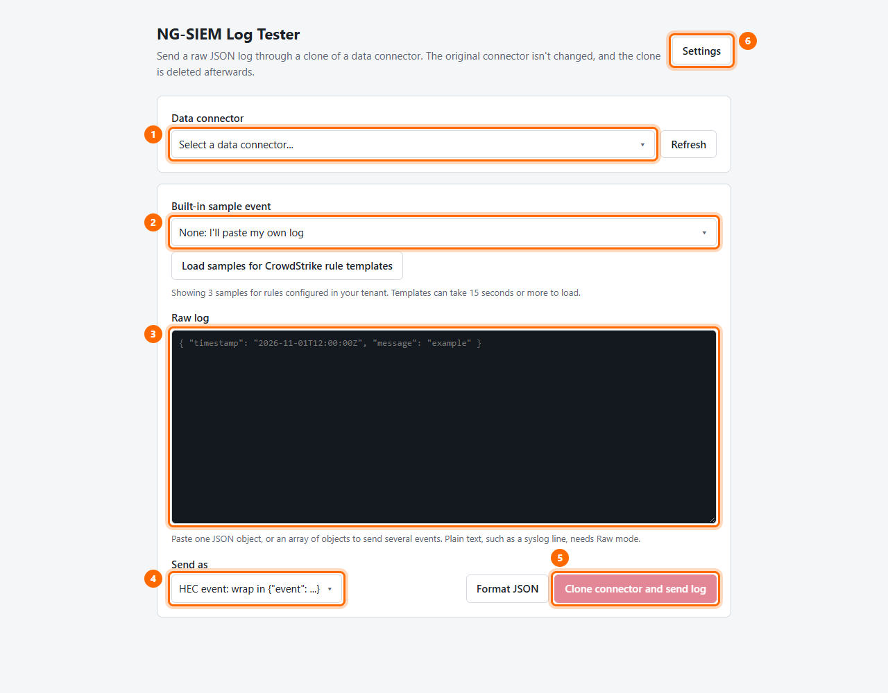

| # | Control | What it does |
|---|---|---|
| 1 | **Data connector** | The connector whose parser will process your log |
| 2 | **Built-in sample event** | Fills in a ready-made vendor or rule sample, or leave it as **None** to paste your own log |
| 3 | **Raw log** | The log that will be sent. You can edit it freely |
| 4 | **Send as** | Chooses how the log is sent: wrapped as an HEC event, or raw |
| 5 | **Clone connector and send log** | Sends the log. This button stays disabled until a connector and a log are both set |
| 6 | **Settings** | Branding and contact details for this installation (Step 10) |

## Step 2: Choose a data connector

Click the **Data connector** box to open the list.

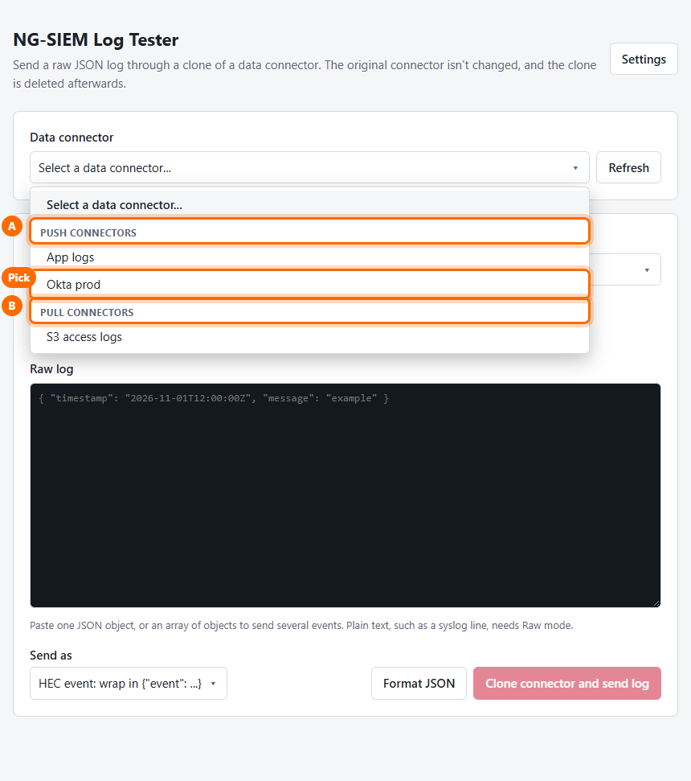

- **A: PUSH connectors.** The log is sent through a clone of this connector.
- **B: PULL connectors.** These are handled differently; see Step 9.
- **Pick:** click the connector you want to test. This example uses **Okta prod**.

The list scrolls, and long names wrap so they stay readable. You can also use the arrow keys and Enter.

## Step 3: Confirm the connector details

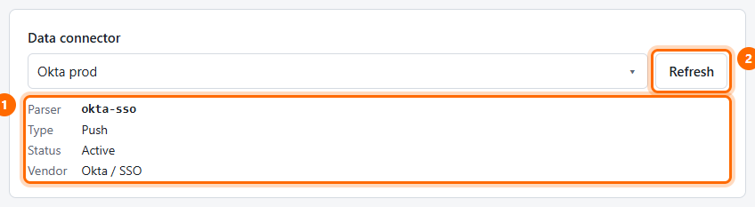

1. Check the **Parser** (here `okta-sso`), along with the type, status and vendor. The parser is what turns your log into NG-SIEM fields, so make sure it's the one you meant to test.
2. **Refresh** reloads the connector list, for example after a new connector is added in Falcon.

## Step 4: Choose a sample, or paste your own log

Click **Built-in sample event** to open the sample list.

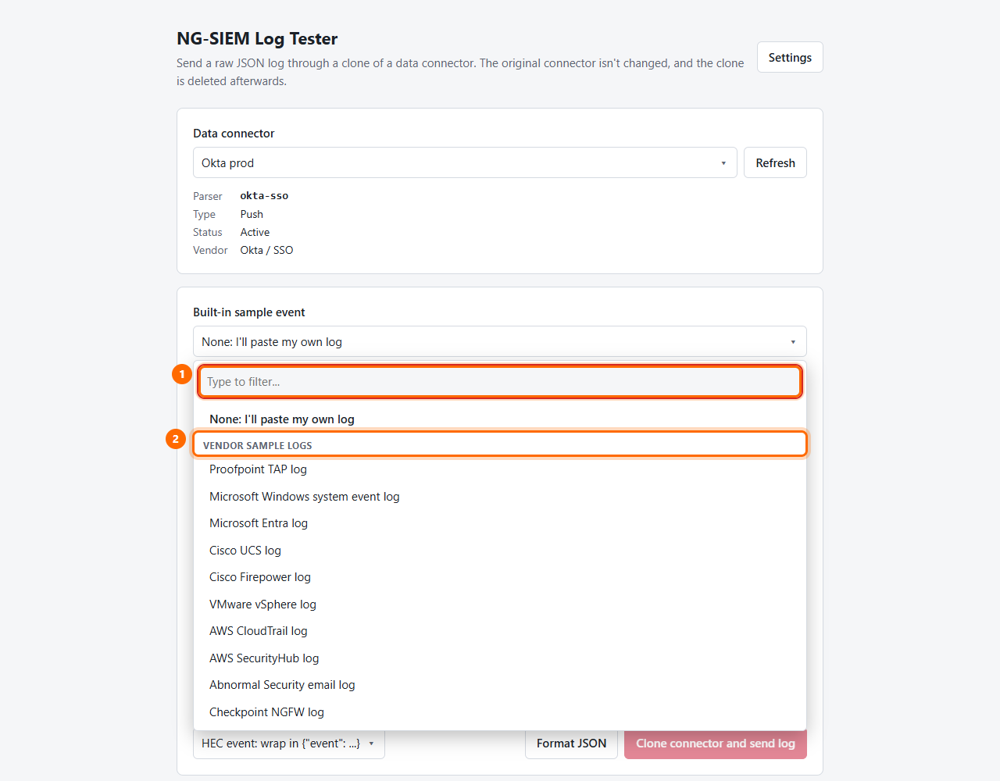

1. **Type to filter:** type part of a name, such as `okta` or `palo`, to shorten the list.
2. **Vendor sample logs:** realistic logs in the format each vendor's NG-SIEM parser expects, such as Proofpoint TAP, Windows XML, Palo Alto CSV and Fortinet key=value.

Scroll further down to see the samples generated from correlation rules.

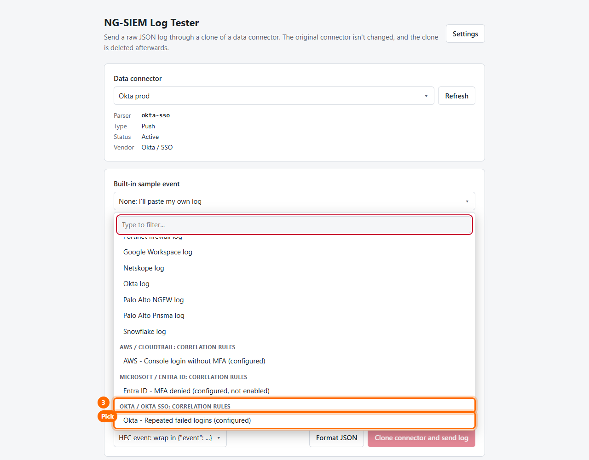

3. **Correlation rule groups:** samples built to match a correlation rule, grouped by vendor and product. Labels show whether a rule is configured in your tenant, and whether it is **not enabled**.
- **Pick:** this example uses **Okta - Repeated failed logins (configured)**.

To use your own log instead, leave the sample on **None: I'll paste my own log** and paste into **Raw log**. Paste one JSON object, or an array of objects to send several events. Plain text, such as a syslog line, needs **Raw** mode (Step 6).

> All sample logs contain the marker `NGSIEM-LogTester-TEST`, which makes them easy to find in Advanced Event Search afterwards.

## Step 5: Review the correlation rule check

After a sample loads, or whenever you edit the log, the app estimates which rules the log is likely to fire.

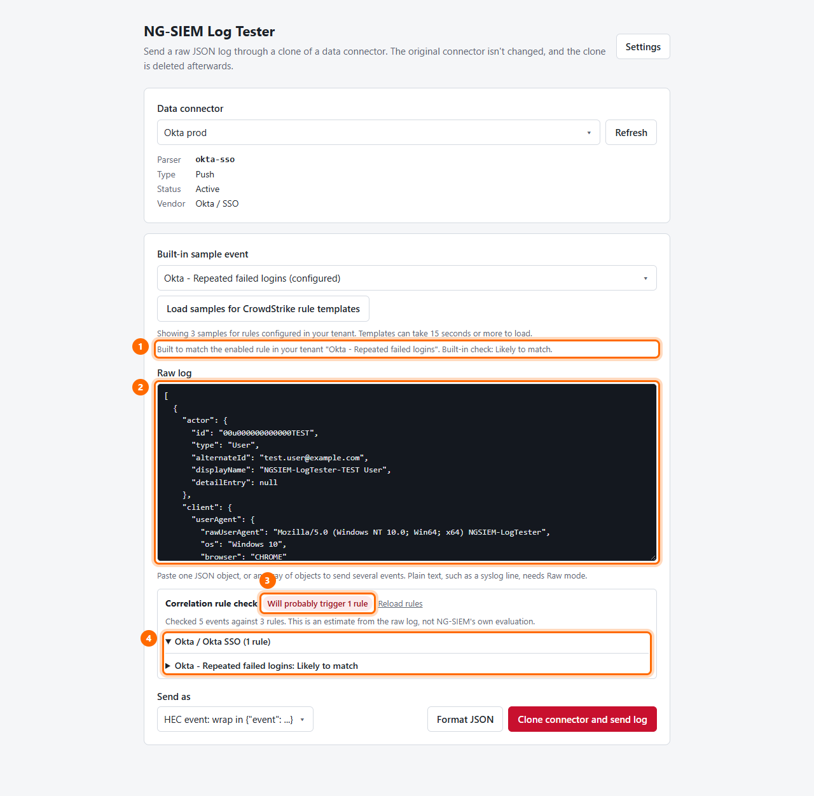

1. **Sample note:** says which rule the sample was built for and gives the app's own verdict, plus a link to the format reference for vendor samples.
2. **Raw log:** the sample is placed here and can be edited.
3. **Badge:** a summary, such as **Will probably trigger 1 rule**. **Reload rules** fetches rules again after you change them in Falcon.
4. **Rule list:** matching rules, grouped by vendor and product.

Click a rule to see why it matches:

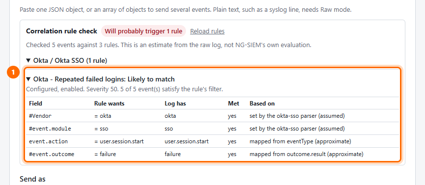

The table lists each condition the rule needs (**Rule wants**), the value in your log (**Log has**), whether it is met, and how the value was worked out (**Based on**). When a rule *almost* matches, the app suggests what to change in the log.

> **This is an estimate.** The app reads the raw log and predicts the parser's fields. NG-SIEM's own evaluation is the final answer.

### Optional: include CrowdStrike's rule templates

By default, only rules configured in your tenant are checked, which takes a single API call. To also get samples and checks for CrowdStrike's published rule templates:

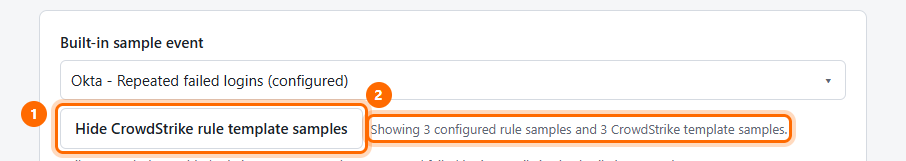

1. Click **Load samples for CrowdStrike rule templates**. Loading can take 15 seconds or more, because there are over 1,600 templates. Click the button again to hide them.
2. The status line shows how many configured-rule and template samples are listed.

## Step 6: Choose how to send the log

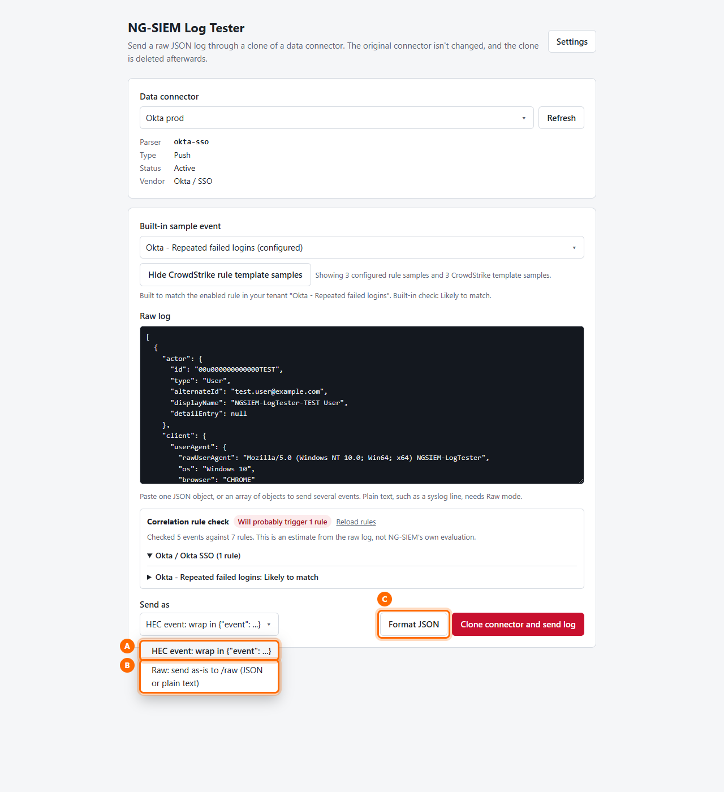

- **A: HEC event** wraps each JSON object as `{"event": ...}`. Use this for JSON logs, which covers most vendor samples.
- **B: Raw** sends the text as-is to the `/raw` endpoint. Use it for plain-text logs such as syslog, CSV or key=value, or when the parser expects the exact original bytes.
- **C: Format JSON** pretty-prints the log and flags invalid JSON before you send it.

## Step 7: Send the log and acknowledge any rules that will fire

Click **Clone connector and send log**.

If the log is likely to fire an **enabled** rule in your tenant, a warning appears first. **Nothing is sent until you confirm.**

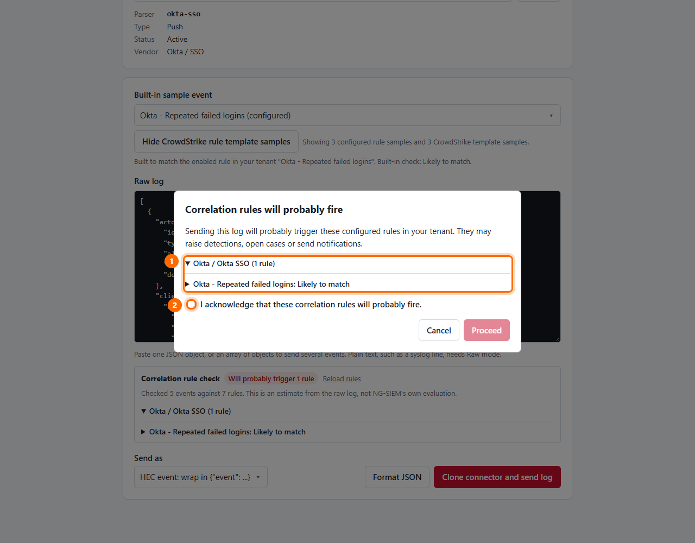

1. Review the rules that will probably fire. Firing them may raise detections, open cases or send notifications to your SOC.
2. Tick **I acknowledge that these correlation rules will probably fire.**

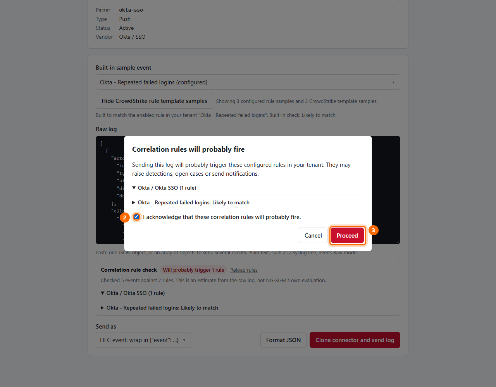

3. Click **Proceed** to send the log, or **Cancel** to go back and edit it.

Each acknowledgement is recorded in the forensic log. The server checks it again, so a submission without one is refused.

> Tip: before sending a log that will fire a rule, tell your SOC, or search afterwards for detections that mention `NGSIEM-LogTester-TEST`.

## Step 8: Read the result

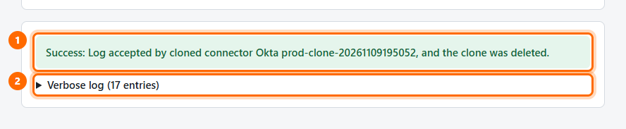

1. **Result banner:** green means the cloned connector accepted the log and the clone was deleted. Red explains what failed, for example a rejected log, a missing scope, or a clone that couldn't be deleted (the banner then names the clone so you can remove it in Falcon).
2. **Verbose log:** click it to see every step and API call, with tokens redacted.

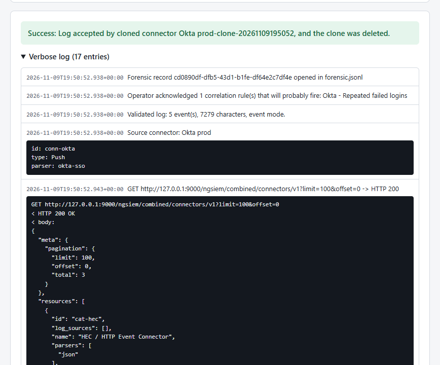

The verbose log shows, in order:
- the forensic record ID;
- your acknowledgement;
- validation;
- the source connector;
- each API call (clone, token, ingest, delete) with its HTTP status.

Use it when troubleshooting, or attach it to a ticket.

**To confirm the parser worked,** search Falcon **Advanced Event Search** for `NGSIEM-LogTester-TEST` a minute or two later, and check that the fields came out as expected.

## Step 9: Testing a PULL connector

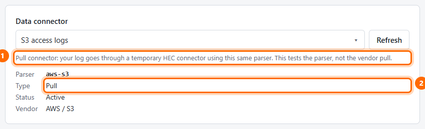

1. A PULL connector, such as an S3 or API poller, has no endpoint to push to. So the app sends your log through a **temporary HEC connector that uses the same parser**.
2. **Type: Pull** confirms that this connector type is selected.

This tests the **parser**, not the vendor's pull integration itself.

## Step 10: Brand the app and add contact details (administrators)

Click **Settings** in the top-right corner.

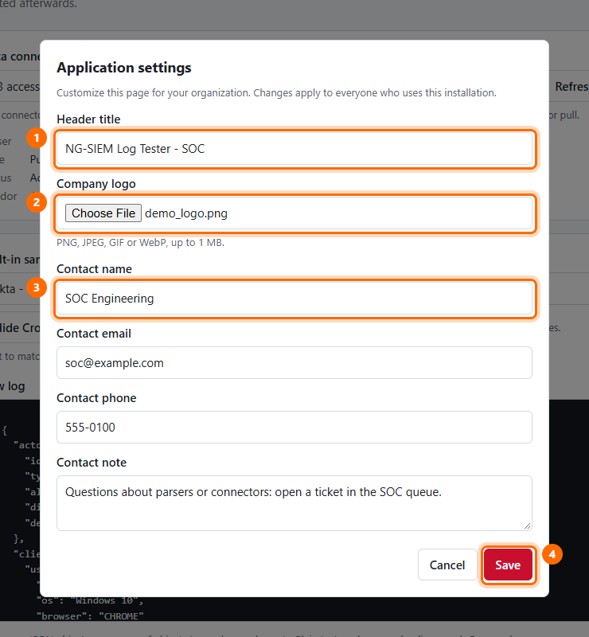

1. **Header title:** replaces "NG-SIEM Log Tester" at the top of the page.
2. **Company logo:** PNG, JPEG, GIF or WebP, up to 1 MB. Once a logo is set, a **Remove the current logo** option appears.
3. **Contact details:** name, email, phone and a short note, for example who to ask for help or a ticket queue.
4. **Save** applies the changes for everyone who uses this installation.

If `APP_ADMIN_PASSWORD` is set in `.env`, the dialog also asks for that password before saving. Every change is recorded in the forensic log as `settings_changed`.

The result:

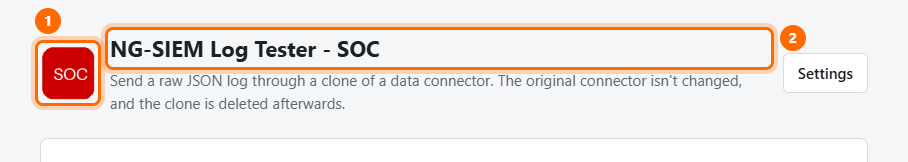

1. The logo and 2. the title appear in the header.

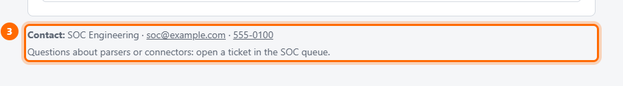

3. The contact details appear at the bottom of the page.

Settings are stored locally in `app_settings.json` and `branding/`. Git ignores both.

---

## Quick reference

| I want to... | Do this |
|---|---|
| Test a vendor parser | Pick the connector, choose a **Vendor sample log** (or paste your own), and send |
| Check that a rule fires | Pick the rule's sample, review the rule check (Step 5), send, and acknowledge |
| Avoid firing rules | Edit the log until the badge shows no rules, or use a connector whose rules are disabled |
| Send syslog, CSV or key=value text | Set **Send as** to **Raw** |
| See what happened | Open **Verbose log**, or read `logs/forensic.jsonl` |
| Find the test events | Search Advanced Event Search for `NGSIEM-LogTester-TEST` |

## Troubleshooting

| Symptom | Likely cause and fix |
|---|---|
| The connector list is empty, or there's an authorization error | Check `.env` credentials, `FALCON_BASE_URL` for your cloud, and the **NGSIEM Data Connections** scope |
| The rule check says rules couldn't be loaded | Add the **Correlation Rules: Read** scope, then click **Reload rules** |
| **Clone connector and send log** is greyed out | Choose a connector and enter a log first |
| A "log rejected" error for plain text | Switch **Send as** to **Raw** |
| A warning that the clone wasn't deleted | Delete the named clone in Falcon under Data connectors |
| A settings save is refused | Enter the `APP_ADMIN_PASSWORD` from `.env` |
| Port 5000 is already in use | Set `PORT=5050` (or another free port) in `.env` and restart |
| Can't connect from another machine | Set `HOST=0.0.0.0` in `.env`, open the port in the server's firewall, and restart (see "Before you start") |
| Still can't connect after setting `HOST` | Check that the startup output says `Running on all addresses`, test with `curl http://127.0.0.1:5000` on the server, then check the firewall, including any cloud security group |
